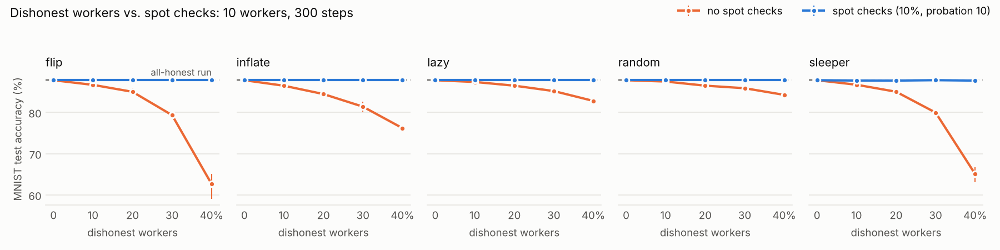

# seedling

**Train models on pooled, unreliable hardware by sharing only random seeds and scores.**

seedling trains with *evolution strategies* (ES): workers try random changes to the model,
score them with forward passes only, and report the scores. Every random change is rebuilt
from a 64-bit seed, so a whole training step travels as a few hundred bytes, whatever the
model size. Each worker replays the same steps with exact integer arithmetic in C, so every
copy of the model stays **bit-for-bit identical**: on a laptop CPU, a laptop GPU, or a
Kaggle notebook behind NAT, even when workers or the coordinator crash. Workers you don't
trust are spot-checked by other workers, and liars are banned before their scores count.

Built from first principles as a learning project: sockets, collectives, DDP, ES, a
counter-based RNG, a write-ahead journal and an LLM fine-tuning demo, all written and tested
here.


A 40-second explainer, made with Manim (`video/explainer.py`). Full quality: [mp4](https://github.com/4arkeinlvy/seedling/raw/main/assets/seedling-explainer.mp4).

## Results (one laptop: i5-12450H, RTX 3050 4 GB)

| What | Result |
|---|---|
| Ring all-reduce in C vs Python | 7x lower latency (41 µs vs 299 µs), up to 2.2 GB/s |
| DDP from scratch vs 1 process | same loss to 7e-8, same weights to 7e-6 |
| ES on CartPole | perfect policy (return 500) in 14 steps |
| ES on MNIST (MLP, 300 steps) | 87.4% with exact integer ES, vs 91.7% backprop |
| Bytes per training step | 392 bytes (32 seeds), any model size; DDP sends 438 KB for a 112k-parameter model |
| Exact update in C | 5.8 billion sign-adds/s, identical bits for any thread count |
| Chaos test | `kill -9` of workers and coordinator: final weights bit-identical to a clean run |
| Dishonest workers (MNIST, 3 of 10 reverse their scores) | 79.3% without defense; **87.8% with spot checks**, bit-identical to an all-honest run, for 10% extra work |
| Qwen2.5-0.5B on Countdown | see [Qwen experiment](#qwen-experiment) |

## How it works

```
workers (any machine)                                   coordinator
  GetWork                        ---------------->   hands out seed pairs for step t
  score  theta + sigma*eps(seed) and  theta - sigma*eps(seed)   (forward passes only)
  Submit(scores, my state hash)  ---------------->   checks the hash, waits for all pairs
  Sync                           <----------------   StepRecord(t, seeds, integer coefficients)
  state += sum_i q_i * eps(seed_i)   exact int32 math in C        journal: append + fsync
```

- **Exact state, inexact evaluation:** scores can be computed in any precision on any
  device. Only the update must be exact, and it uses only integers: `q_i` is an integer, the
  noise is ±1 from Philox4x32-10.
- **Replicated log:** a training run is its journal of step records. `seedling replay`
  rebuilds the final weights from it.
- **Low-rank noise for LLMs:** each seed perturbs selected layers with a rank-1 matrix
  `b aᵀ`, so the whole population runs in one batched `generate` call.

## Install

```bash
pip install "seedling[llm] @ git+https://github.com/4arkeinlvy/seedling"
```

Linux, Python 3.13, a C compiler with OpenMP (the C core is built during install).
For development:

```bash
git clone https://github.com/4arkeinlvy/seedling && cd seedling
nix-shell            # NixOS: gcc, gdb, valgrind, CUDA driver path; skip on other distros
uv sync              # Python deps, PyTorch with CUDA
make && make test-c  # C core (-march=native) and its tests under ASan/UBSan
uv run pytest        # tests (add -m heavy or -m llm for the slow ones)
```

## Use it

Train in one process:

```bash
seedling train --task cartpole --steps 30
seedling train --task mnist --steps 300 --pop 50 --sigma 0.05 --lr 0.01
python -m seedling.llm.train --steps 40           # Qwen2.5-0.5B on Countdown (GPU)
```

Train across machines:

```bash
# machine A
seedling coordinator --task cartpole --steps 30 --run-dir runs/cp \
    --listen tcp://0.0.0.0:7070 --listen http://0.0.0.0:7080

# any other machine on the LAN
seedling worker --connect tcp://<machine-A>:7070

# a Kaggle or Colab notebook: expose port 7080 with a tunnel
# (e.g. `cloudflared tunnel --url http://localhost:7080`), then in the notebook:
seedling worker --connect https://<tunnel-url>

# afterwards, anywhere
seedling replay --run-dir runs/cp
```

Workers can join, leave or crash at any time. Pairs handed to a dead worker go to another
one after `--deadline` seconds, and a restarted coordinator resumes from its journal.

Open to workers you don't trust? Add spot checks (needs at least 3 workers):

```bash
seedling coordinator --task mnist --steps 300 --pop 50 --sigma 0.05 --lr 0.01 \
    --run-dir runs/mnist --audit-rate 0.1 --probation 10
```

## Qwen experiment

`python -m seedling.llm.train --steps 40 --pop 32 --prompts 16 --sigma 0.002 --lr 3e-5`:
Qwen2.5-0.5B-Instruct learns the arithmetic game *Countdown* (use each given number once to hit
a target) with forward passes only. Trainable: `o_proj` and `down_proj` of the last 8 blocks
(41.3M parameters), rank-1 ±1 noise, exact int32 updates.

| 128 held-out problems | before | after 40 steps |
|---|---|---|
| well-formed answers (each given number used exactly once) | 86.7% | **93.8%** |
| exactly correct | 1.6% (2/128) | 3.1% (4/128) |

12 minutes on an RTX 3050 (1.64 GB VRAM peak), 1,024 generations per step, 392 bytes per step
on the wire. The format gain is clear. The accuracy change is too small to call (2 → 4 of 128):
published ES results on LLMs use hundreds of steps and larger populations. The same workload
runs through the distributed runtime (`seedling coordinator --task countdown`); the
coordinator reads only the model's config and needs no GPU.

## Dishonest workers

A worker's only input to training is its scores, so a dishonest worker lies about scores.
`seedling coordinator --audit-rate r --probation P` defends against this:

- **Audits.** With probability `r`, a pair that one worker scored also goes to a second worker.
  Work messages look the same either way and fresh pairs go out in a secret random order, so
  a worker can't tell an audit from new work. Scores match within a tolerance, because
  workers may run on different devices.
- **Probation.** A new worker id has *all* its pairs audited until it passes `P` audits.
  Ids are issued by the coordinator, so nobody can submit under another worker's id, and
  every new identity first has to do `P` pairs of honest work.
- **Vote and ban.** On a mismatch a third worker scores the pair, and the strict majority
  wins. The outvoted worker is banned, and its other scores in the open step are taken back
  before the step commits. Bans survive a coordinator restart (`audit.json`).



`python -m bench.bench_byzantine`: MNIST, 10 simulated workers, 300 steps (15,000 scored
pairs), 3 seeds per point, spot checks at `r = 0.1, P = 10`. The simulator drives the real
coordinator (`seedling/runtime/simulate.py`). Attacks: **flip** swaps F+ and F- (pushes the
model the wrong way), **inflate** reports ±10⁹, **lazy** skips the work and sends zeros,
**random** sends another pair's scores, **sleeper** is honest through probation and then flips.

| 30% of workers dishonest | no defense | spot checks | lies committed per run | extra work |
|---|---|---|---|---|
| flip | 79.3% | **87.8%** | 4,427 → 0 | 10% |
| inflate | 81.4% | **87.8%** | 4,500 → 0 | 10% |
| lazy | 85.2% | **87.8%** | 4,500 → 0 | 10% |
| random | 85.9% | **87.8%** | 4,497 → 0 | 10% |
| sleeper | 79.9% | **87.8%** | 4,369 → 6 | 11% |

All-honest accuracy is 87.8%. At 40% flippers, an undefended run drops to 62.6%. With spot
checks, every one of the 150 dishonest workers in the grid was banned. In 16 of the 20
settings, every run ended **bit-identical** to the all-honest run with the same seed: the
lies never reached the journal.

**Why the undefended runs degrade gracefully.** Scores go through centered ranks before
they become coefficients, so a lie only counts through its rank, never its size. If `m`
of `N` pairs report anything at all, the antithetic weights move by at most
`2m + 4m(N−m)/(2N−1)` in L1, and no coordinate of the update moves by more than that times
`lr/(2Nσ)` (`influence_bound`, tested against arbitrary lies). With raw scores, one lie of
10⁹ would dominate the update, and here it would overflow the int32 coefficients.

**Limits, measured.** Spot checks assume that the workers auditing a pair are mostly honest:
- **Sleepers.** Once past probation, a sleeper is caught after about `(1−r)/r` unaudited
  lies on average, so 6–19 lies per run got through. Thanks to the rank bound they cost at
  most 0.1 points of accuracy.
- **Framing.** With 30–40% colluding workers, two liars sometimes audited the same honest pair
  and outvoted the honest worker 2 to 1: 1–4 honest bans per 3 runs. Their work was redone, so
  accuracy did not change, but it shows where the honest-majority assumption breaks.
- **Sybils.** Real Sybil resistance needs authenticated or costly identities; probation only
  makes each new identity pay in honest work first.

## Layout

```
csrc/            C core (ctypes): ring all-reduce, Philox RNG, exact integer updates, xxHash64
seedling/
  foundation/    launcher, framing, TCP store, collectives, DDP
  tasks/         workloads: tiny GPT, DDP training, CartPole (physics from scratch), MNIST
  es/            float ES: noise, ask/tell, optimizers, evaluators, BatchedMLP
  exact/         bit-exact core: fixed-point state, step records, integer ES, replay
  runtime/       coordinator, workers, journal, TCP/HTTP transports, Workload interface,
                 spot checks and bans (audit.py), a simulator of dishonest workers (simulate.py)
  llm/           Countdown, low-rank population layers, Qwen workload
  cli.py         seedling train | coordinator | worker | replay
tests/           the spec: 270 Python tests (heavy = multi-process, llm = GPU) + 5 C test programs
bench/           all-reduce bandwidth, DDP step time, ES curves, dishonest workers
assets/          the rendered explainer (GIF for the README, mp4), the dishonest-workers figure
video/           its Manim source (video/explainer.py)
```

## Roadmap

| | Milestone | What was built |
|---|---|---|
| [x] | **M0** tiny GPT | character-level GPT in PyTorch |
| [x] | **M1** comm layer | framing, rendezvous store, collectives, ring all-reduce in Python and C |
| [x] | **M2** DDP | data-parallel training from scratch: buckets, overlap, `no_sync` |
| [x] | **M3** ES | evolution strategies on CartPole, MNIST and the tiny GPT |
| [x] | **M4** bit-exact core | Philox, int32 fixed-point updates, xxHash64, replay |
| [x] | **M5** runtime | coordinator, workers, write-ahead journal, TCP/HTTP, chaos test |
| [x] | **M6** LLM | low-rank exact ES on Qwen2.5-0.5B-Instruct (Countdown) |
| [x] | **M7** package | pip-installable wheel with the C core, `seedling` CLI, CI |
| [x] | **M8** dishonest workers | strict protocol checks, spot checks, probation, vote and ban, influence bound, attack simulator |

Next ideas: Raft-replicated journal (no single point of failure), authenticated worker
identities (Sybil resistance), int8 forward kernels.

## License

MIT
